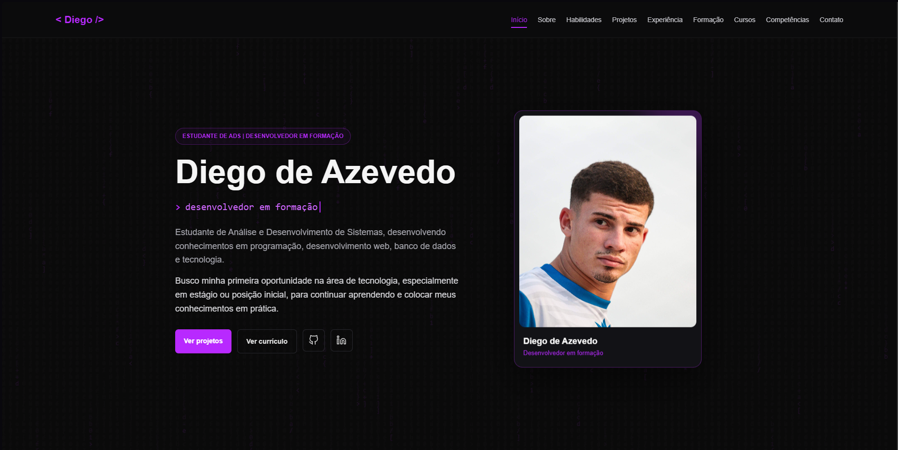

# Diego de Azevedo — Portfólio

Portfólio pessoal de **Diego de Azevedo**, estudante de Análise e Desenvolvimento de Sistemas (ADS) e desenvolvedor em formação, em busca da primeira oportunidade na área de tecnologia (estágio ou posição inicial).

🔗 **Site no ar:** [iwnldev.github.io/Portf-lio-Diego](https://iwnldev.github.io/Portf-lio-Diego/)



---

## 📌 Sobre o projeto

Este site reúne minha trajetória, formação, cursos, projetos e informações de contato em um só lugar. Foi construído do zero, sem frameworks, para praticar os fundamentos do desenvolvimento web: estrutura semântica, estilização responsiva e interações com JavaScript.

## ✨ Seções do site

- **Início:** apresentação e objetivo profissional
- **Sobre mim:** quem sou e de onde venho
- **Habilidades:** tecnologias e ferramentas que venho estudando
- **Projetos:** o que já construí, com link do site e do código
- **Experiência profissional:** atuação anterior como escrevente em cartório
- **Formação:** ADS (em andamento) e Direito (até o 5º semestre)
- **Cursos e certificações:** Cisco/OpenEDG, IBM SkillsBuild, OneBitCode, Cursa, Fundação Bradesco, XP Inc. e outros
- **Competências**
- **Contato:** e-mail, GitHub, LinkedIn e currículo em PDF

## 🛠️ Tecnologias utilizadas

| Tecnologia | Uso no projeto |
| --- | --- |
| **HTML5** | Estrutura semântica das páginas (`header`, `nav`, `main`, `section`, `article`) |
| **CSS3** | Layout, estilização e responsividade |
| **JavaScript** | Interações da página (como o menu mobile) |
| **Devicon** | Ícones das tecnologias na seção de habilidades |
| **Git e GitHub** | Controle de versão e hospedagem do código |
| **GitHub Pages** | Publicação do site |

## 📂 Estrutura do repositório

```
Portf-lio-Diego/
├── curriculo/       # Currículo em PDF
├── imagens/         # Foto de perfil e prévias dos projetos
├── index.html       # Estrutura da página
├── estilo.css       # Estilos e responsividade
├── script.js        # Interações em JavaScript
├── LICENSE
└── README.md
```

## 🚀 Como rodar localmente

Não há dependências para instalar. Basta clonar o repositório e abrir o `index.html` no navegador:

```bash
git clone https://github.com/iwnldev/Portf-lio-Diego.git
cd Portf-lio-Diego
```

Depois abra o arquivo `index.html` com um duplo clique ou, se preferir, use a extensão **Live Server** do VS Code.

## 📚 O que aprendi com este projeto

- Organizar uma página longa com HTML semântico e boas práticas de acessibilidade (`alt` nas imagens, `aria-label` e `aria-expanded` no menu mobile)
- Criar layouts responsivos com CSS para diferentes tamanhos de tela
- Usar JavaScript para tornar a página interativa
- Versionar o trabalho com Git e publicar com GitHub Pages
- Preparar uma página pensando em quem vai ler: recrutadores e profissionais da área

## 🔭 Próximos passos

- [ ] Adicionar mais projetos com lógica em JavaScript, Python e SQL
- [ ] Conectar o formulário de contato a um serviço de envio de e-mail
- [ ] Adicionar favicon e completar as tags de compartilhamento (Open Graph e Twitter Card)
- [ ] Reorganizar a seção de cursos, destacando os principais
- [ ] Melhorar a acessibilidade (hierarquia de títulos e navegação por teclado)

## 🐾 Outros projetos

- [**PetLife**](https://github.com/iwnldev/PetLife): projeto web com HTML, CSS e JavaScript · [ver no ar](https://unrivaled-creponne-169aca.netlify.app)

## 📫 Contato

- **E-mail:** diegocerqueira19@outlook.com
- **LinkedIn:** [linkedin.com/in/diegoazevedoo](https://www.linkedin.com/in/diegoazevedoo/)
- **GitHub:** [github.com/iwnldev](https://github.com/iwnldev)

## 📄 Licença

Distribuído sob a licença MIT. Veja o arquivo [LICENSE](LICENSE) para mais detalhes.

---

Desenvolvido por **Diego de Azevedo** 💻
